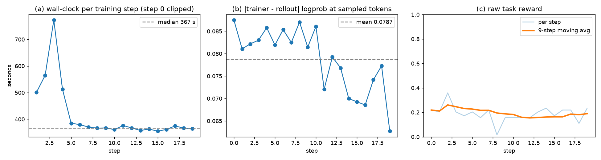

# GLM-5.3-Flash — native Daytona TB2 on eight Rubin nodes

Fully asynchronous GRPO on OpenEnv's **Terminal-Bench-2** environment with GLM-5.3-Flash
(full 45 layers), four training nodes and four rollout nodes with four GPUs each. Every
episode runs in its own **Daytona** sandbox created from the task's official image through
the **native** Miles Daytona provider — no OpenSandbox provider, no Miles source overlay.
Only the launcher in this directory is new; the agent loop, the TITO session server, the
Daytona materialization and the fully-async scheduler are the unmodified upstream code.

What ran on 2026-10-15 (all on the pinned image below):

| Stage | What | Result |
|---|---|---|
| M1 | `scan_golden.py --tasks fix-git` on one Daytona sandbox (no model) | canonical `tests/test.sh` reward 1.0, sandbox 404 after delete |
| M2 | GLM multi-turn sampling through the real agent loop, 1 + 8 trajectories (2 nodes, one TP8 engine) | first-turn roles correct, 30-turn model→tool→model episodes, tokens / logprobs / loss-mask aligned, no TITO prefix mismatch |
| M3 | 3 optimizer updates on 8 nodes with the formal settings | every update: 16/16 trainer ranks normal, finite loss/grad, broadcast to both engines; held-out eval 0.2 (8/40) before → 0.175 (7/40) after |
| 20 steps | 20 optimizer updates, evaluation off, step-time / log-prob-divergence / reward series | figure below |



(a) wall-clock per training step, median **367 s** over steps 1–19 (355–385 s from step 5 on;
step 0 includes the first rollout and is clipped); (b) mean |trainer − rollout| log-probability
at sampled tokens, **0.0787** on average, 0.0875 → 0.0627; (c) raw task reward per step
(before GRPO centering), mean 0.188, nine-step moving average 0.219 → 0.189. These are the
same three quantities as Figure 5 of the Miles v0.1 report (§9, GLM-5.2 744B on 64 GB300:
263 s median, 0.0369, 0.438 → 0.556); the reward here stays flat, which is the expected
outcome for a 20-step functional run and is not a learning claim. The per-step numbers are in
[`assets/fig5-series.csv`](assets/fig5-series.csv).

## Container

Base image: **`miles-rubin-dev:sgfix-20261011-j2460554` (internal)**, built from the Rubin
Dockerfile of [radixark/miles#4011](https://github.com/radixark/miles/pull/4011)
(`docker/Dockerfile.rubin`). Pin it by digest; do not use a moving tag. The stack this recipe
was validated on:

| Component | Revision | Where |
|---|---|---|
| Miles | `0d9d726e0f9b9d487c36a0c342012b917820fb04` | image, `/opt/miles` |
| SGLang | `6b5f3dfc5a395d6fd56d105c34c8e3542846ca4c` | image |
| Megatron-LM | `fd15ee20a4f03b03680529baf4b8f7eeed64df1d` | image, `/root/Megatron-LM`; `install_deps.py` copies it to `/opt/Megatron-LM` when `/root` is unreadable for the run UID, as it is here |
| Daytona SDK | `0.224.1` | added by `install_deps.py` |
| OpenEnv incl. `tbench2_env` | `38b2a31354d1d4d627894412b9d469e92f4a2c61` | checkout under `/work`, installed editable from a copy at `/opt/OpenEnv` by `install_deps.py` |
| Terminal-Bench-2 | `2fd12b88aafdd04a52c298e3940bcb189f9766d6` | checkout at `/work/terminal-bench-2` with a GitHub `origin` |

The image already carries the Rubin / GLM-5.3 model support. Do not overlay an older Miles
tree onto `/opt/miles` and do not reapply historical GLM parser, template, timeout or
strict-filter patch bundles.

## What has to be added to the image

### 1. Dependencies — [`install_deps.py`](install_deps.py)

The image has no Daytona SDK and no OpenEnv. `install_deps.py` adds them without moving the
image's own stack: `plan` resolves the request against a constraints file that pins every
package already installed, writes a hash-locked requirements file and changes nothing;
`apply` installs exactly the reviewed lock with `--no-deps --require-hashes`, installs OpenEnv
and `tbench2_env` editable from a copy at `/opt/OpenEnv`, relocates Megatron-LM to
`/opt/Megatron-LM` when `/root` is unreadable for the run UID, and applies the one source
change below; `verify` runs as the run UID and imports everything the launcher needs. The
script reads fixed paths: the OpenEnv checkout at `/work/OpenEnv`, and
`initial-snapshot-retry.patch` plus `known-versions.json` under `/work/inputs/` (that is where
`site/prepare_run.sh stage-tools` puts them); it writes its plan, lock and receipt under
`/opt/tb2-daytona-install/`.

Observed delta on the pinned image: 52 new wheels (`daytona==0.224.1` with its six
`daytona-*-api-client` packages, `fastmcp==3.4.8`, `mcp==1.30.0`, `openai==2.7.2`, and the
packages in [`known-versions.json`](known-versions.json)) plus the two editable installs.
Only two existing packages move, because the OpenEnv / fastmcp stack requires it:
`openai` 2.6.1 → 2.7.2 and `mcp` 2.3.0 → 1.30.0. The server side of `tbench2_env` (Gradio and
the other server extras) is not installed in the training container; each sandbox image
installs it into its own venv from the embedded `tbench2_env` package source.

```bash
# inside the container, as root; everything is written under /opt/tb2-daytona-install
python3 install_deps.py plan            # installation-plan.json, pip-plan.json, resolved-requirements.txt
python3 install_deps.py apply --uid <run uid> --gid <run gid> \
    --approved-plan-sha256 <sha256 of installation-plan.json>      # writes receipt.json
# as the run UID
python3 install_deps.py verify
```

### 2. One source change — radixark/miles#4029

The only Miles source change is
[radixark/miles#4029](https://github.com/radixark/miles/pull/4029): keep the first successful
inference-engine weight snapshot across reset retries, so the strict initial weight
comparison keeps its reference. The pinned image predates it; `install_deps.py apply` applies
the bundled [`initial-snapshot-retry.patch`](initial-snapshot-retry.patch) (one file,
`miles/ray/rollout/server_cell.py`). Nothing else in `/opt/miles` is touched. The patch file is
cut against the pinned Miles revision; it does not apply to current `main`, where the snapshot
call has since changed shape, so on a newer tree take the PR itself.

## Files in this directory

| File | Role |
|---|---|
| [`run_glm5_3_flash_tb2_daytona.py`](run_glm5_3_flash_tb2_daytona.py) | The launcher. Derived from the GLM-5.3-Flash Rubin OpenSandbox recipe launcher (not in this tree; [`../glm52_tbench2`](../glm52_tbench2/README.md) is the upstream 64-GPU GLM-5.2 version of the same shape) with three changes: the agent function is the native `openenv_daytona_agent_function.run`, credentials go through Miles' key-file forwarding (`provision_provider`, path only), and a `--debug-rollout-only` mode samples on two nodes without an optimizer. |
| [`launch_train.sh`](launch_train.sh) | Head-container wrapper: environment, dataset hashes, `m2` (debug sampling) and `m3` (training) entry points. |
| [`install_deps.py`](install_deps.py), [`known-versions.json`](known-versions.json) | Dependency plan / apply / verify as above. |
| [`initial-snapshot-retry.patch`](initial-snapshot-retry.patch) | radixark/miles#4029 as a patch file. |
| [`site/`](site/) | Site adapters for a Slurm + Docker cluster, listed below. They are the scripts that produced the runs above; another site will need its own equivalents. |
| [`assets/`](assets/) | The figure and its per-step series. |

`site/`, in the order they are used:

| File | Role |
|---|---|
| `discover_nodes.sh` | One-shot inventory of every allocated node (GPUs, IMEX channel, `/raid` space, image presence, model caches). |
| `prepare_run.sh` | Login-node step driver: `stage-node`, `stage-model`, `spec`, `bootstrap`, `stage-tools`, `install`, `apply`, `key`, `nccl`, `ray-ready`, `evidence`, `restage-tools`, `cleanup-key`, `cleanup-containers`, `fetch`. Site settings come from `SCRATCH_ROOT`, `RUN_PREFIX`, `KEY_STAGING`, `IMAGE_REF`, `IMAGE_ID`, `MODEL_SOURCE`, `MODEL_CACHE`, `KNOWN_GOOD_CACHE`, `NODE_ROOT`, `CIFS_VIEW` (documented in its header). |
| `stage_model_node.py` | Node-local checkpoint cache: reuse a cache whose file set, sizes and SHA256 match the reference manifest, else copy from the read-only source while hashing. |
| `make_run_spec.py` | Writes `run-spec.json` for the allocation: nodes ordered by fabric IP (first = Ray head), image reference and id, node root, per-node verified model path. |
| `bootstrap_node.py` | Starts one idle run container per node from the spec (`--user uid:gid --gpus all --network host --ipc host`, IMEX device, `/work` `/tmp` and the read-only model mounts, lifetime bounded by the Slurm end time, label `miles.run=<run id>`). |
| `receive_key_node.py` | Pipes the Daytona key from stdin into `/work/private/daytona.key` in the head container (exclusive create, `0600`); never echoes it. |
| `nccl_smoke.py`, `run_nccl_node.py` | All-rank NCCL all-reduce across the allocation; passes only when the transport is MNNVL (no `via NET/` path). |
| `rubin_node.py` | Per-container Ray daemon (head or worker), pinned to the fabric interface. |
| `ray_ready.py` | Waits until Ray reports every node and GPU. |
| `m1_golden_fixgit.py` | M1: `scan_golden.py` on one Daytona sandbox plus post-delete 404 check, label sweep and credential scan. |
| `sandbox_count.py`, `reconcile_sandboxes.py` | Count / list / delete the sandboxes carrying this run's `openenv-run-id` label. |
| `m3_evidence.py` | Per-update evidence from one node's `dump_details` (trainer ranks, controller outcomes, weight checksums, dumped samples). |
| `fig5_collect.py` | Figure-5 series (JSON, CSV, PNG) from the driver log. |
| `closeout_m3.sh` | Evidence, per-node archive, reconcile, optional key and container removal, in that order. |

### Inputs the site scripts expect

`prepare_run.sh` stages these from `$SCRATCH_ROOT/<run id>/inputs/` onto every node; nothing
in this directory generates them:

| Input | Content |
|---|---|
| `OpenEnv.bundle` | `git bundle` of the OpenEnv commit above (cloned to `/work/OpenEnv`). |
| `terminal-bench-2.bundle` | `git bundle` of the Terminal-Bench-2 commit above (cloned to `/work/terminal-bench-2`; `origin` is reset to the GitHub URL after the clone). |
| `data/tbench2_train69.jsonl`, `data/tbench2_eval.jsonl` | The frozen task split: 69 training tasks and 20 held-out tasks, one row per task in the format [`../make_tbench2_data.py`](../make_tbench2_data.py) produces. The M2 prompt files (`m2-fixgit.jsonl`, one row; `m2-4tasks.jsonl`, four rows) are subsets of the training file. |
| `model-reference-manifest.json` | Per-file sizes and SHA256 of the original GLM-5.3-Flash HF checkpoint, read by `stage_model_node.py`. |
| `initial-snapshot-retry.patch`, `known-versions.json` | Copies of the files in this directory. |

### Node layout used by the scripts

```text
/raid/dldata/<user>-<run-id>/            fresh node-local run root on every node
  work/   -> /work in the container       home, tools/, inputs/, data/, OpenEnv/, terminal-bench-2/,
                                          output/<run>/dump_details, offload/, cache/, ray/, private/
  tmp/    -> /tmp
<model dir> -> /inputs/GLM-5.3-Flash      original HF FP8 checkpoint, read-only, verified by SHA256 per node
/opt/OpenEnv, /opt/Megatron-LM            copies made by install_deps.py apply (root), world-readable
```

The Terminal-Bench-2 checkout under `/work` must have a **GitHub `origin`**: the Daytona
recipe downloads each task directory as the pinned-commit GitHub tarball when it builds the
sandbox image. Containers run as the ordinary UID with `--network host --ipc host`,
`--ulimit nofile=65536:524288`, the node's IMEX channel device, and a lifetime bounded by the
Slurm end time (`/bin/sleep <remaining seconds>` entrypoint).

## Credentials

Only the Ray head needs the Daytona key. Put it in `/work/private/daytona.key` on the head
(directory `0700`, file `0600`, owned by the run UID) through a non-echoing transfer
(`site/receive_key_node.py` reads it from stdin and creates the file exclusively). Set

```bash
export DAYTONA_API_KEY_FILE=/work/private/daytona.key
export DAYTONA_API_URL=https://app.daytona.io/api
```

on the head. The launcher forwards only the **path** and the URL into Ray's runtime env
(`miles.rollout.agentic.credentials.provision_provider`), and `--pin-rollout-manager-to-head`
keeps the agent-function processes on the head, so no other node reads the file. The key must
not appear in command lines, shell history, logs or archives; remove the file (and any staging
copy) after the run's sandboxes have been reconciled.

## Launch

Prerequisites on the head container: the Ray cluster is up on all nodes (one
`python3 /work/tools/rubin_node.py --head-ip <head fabric IP> --interface <fabric NIC>` per
container, started under a long-lived `srun` step or `docker exec`; the head is the node with
the numerically lowest fabric IP; `site/ray_ready.py` confirms every node and GPU), the data files
`tbench2_train69.jsonl` (69 rows) and `tbench2_eval.jsonl` (20 rows) are under `/work/data`,
and the model directory is mounted at `/inputs/GLM-5.3-Flash`.

**M1 — one real Daytona TB2 environment, no model** (any container with the deps):

```bash
OPENENV_SANDBOX_BACKEND=daytona DAYTONA_API_URL=https://app.daytona.io/api \
DAYTONA_API_KEY_FILE=/work/private/daytona.key OPENENV_TB2_TASKS_DIR=/work/terminal-bench-2 \
OPENENV_LAUNCHER=<you> OPENENV_RUN_ID=<run>-m1 \
python3 site/m1_golden_fixgit.py --tasks fix-git --concurrency 1 --out-dir /work/output/<run>/m1
```

Pass criterion: `golden.jsonl` reward 1.0 from the canonical harness, the created sandbox ID
recorded, and `GET /sandbox/<id>` returning 404 after the delete (`m1-summary.json`).

**M2 — a few GLM trajectories, no weight update** (two nodes, one TP8 engine):

```bash
M2_NUM_ROLLOUT=1 M2_PROMPTS=1 M2_SAMPLES=1 M2_CONCURRENCY=1 \
bash launch_train.sh m2 <run>-m2a /work/data/m2-fixgit.jsonl
M2_NUM_ROLLOUT=1 M2_PROMPTS=4 M2_SAMPLES=2 M2_CONCURRENCY=8 \
bash launch_train.sh m2 <run>-m2b /work/data/m2-4tasks.jsonl
```

`--debug-rollout-only` at this Miles revision still initializes Megatron's parallel state on
the engine's eight GPUs, so the launcher states the stub layout explicitly
(`--actor-num-nodes 1 --actor-num-gpus-per-node 8`, TP8/PP1 so a one-sample batch is valid).
Inspect `dump_details/rollout_data/0.pt`: `response_length == len(loss_mask) ==
len(rollout_log_probs)`, `metadata.accumulated_token_ids == tokens`,
`metadata.tito_session_mismatch` empty or only `assistant_text` entries.

**M3 — formal training** (eight nodes):

```bash
bash launch_train.sh m3 <run>-m3 /work/data/tbench2_train69.jsonl /work/data/tbench2_eval.jsonl --num-rollout 3
```

With `--num-rollout 3` and the formal `--eval-interval 10`, this performs the baseline eval
before training and the final eval after the last update, and no mid-run eval.

**20-step series, evaluation off:**

```bash
bash launch_train.sh m3 <run>-fig5 /work/data/tbench2_train69.jsonl /work/data/tbench2_eval.jsonl \
    --num-rollout 20 --eval-interval 0
python3 site/fig5_collect.py --log <driver.log> --out fig5-series.json --csv fig5-series.csv --png fig5.png
```

The launcher's training arguments are the OpenSandbox recipe's: TP4 / PP4 / EP4 / CP1 with
layers 11/11/11/12, full uniform recompute, dynamic batching at 8192 tokens per GPU, optimizer
state streamed to local disk in FP32, two TP8 / EP8 FP8 rollout engines with Triton MoE,
TileLang DSA and BF16 KV cache, 8 prompts × 8 samples = 64 per update, 128 trajectories in
flight with `sample` submission granularity, temperature 0.8, 8192 tokens per turn, 65536
max sequence, 30 turns and 3600 s per episode, GRPO with Adam at 1e-6, clip 0.2/0.28, TIS 0–2,
`check_no_aborted`, strict weight comparison with the `visual.` exclusion, and
`NVTE_FP8_BLOCK_SCALING_FP32_SCALES=1` for the trainers. No checkpoints are saved.

## After a run

1. Collect `dump_details` and the evidence from every node (trainer ranks log on their own
   nodes); `site/m3_evidence.py` summarizes per-update controller outcomes, metrics and weight
   checksums.
2. Reconcile sandboxes: `site/reconcile_sandboxes.py --run-id <run> --out <reconcile.json> --delete`. When the Ray
   job ends, the fully-async producer still has prefetched episodes in flight; their agent
   processes are killed before the provider can delete their sandboxes (98 were left after the
   20-step run, 5 after an 8-trajectory sampling run). Daytona's auto-stop / auto-delete
   backstop would reclaim them later, but reconcile first.
3. Remove the key file(s), then this run's containers (label `miles.run=<run-id>`).

## Known behaviour

- The TB2 tasks `qemu-startup` and `qemu-alpine-ssh` fail to build on Daytona at the recipe's
  first server layer (`apt-get update && apt-get install curl ca-certificates bash` does not
  complete in those task images). The provider raises, the episode aborts, `check_no_aborted`
  drops that prompt's group and the producer samples another prompt; the run continues. Their
  `BUILD_FAILED` sandboxes stay listed until deleted.
- At engine start SGLang logs a traceback from its post-warmup `freeze_gc` self-call and the
  trainers' first `destroy_weights_update_group` returns 400 before any group exists. Both are
  harmless.
- `Daytona.delete()` returns as soon as the request is accepted; a 404 check needs a short
  poll.
